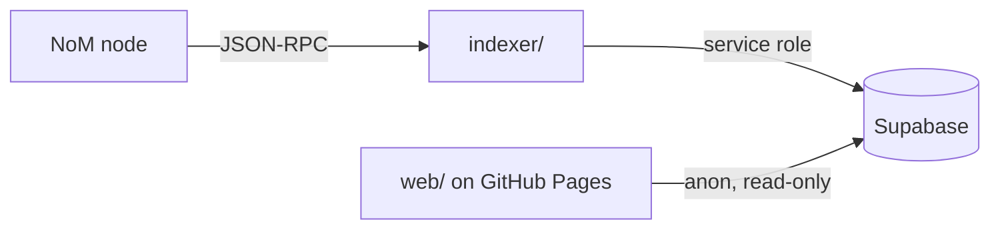
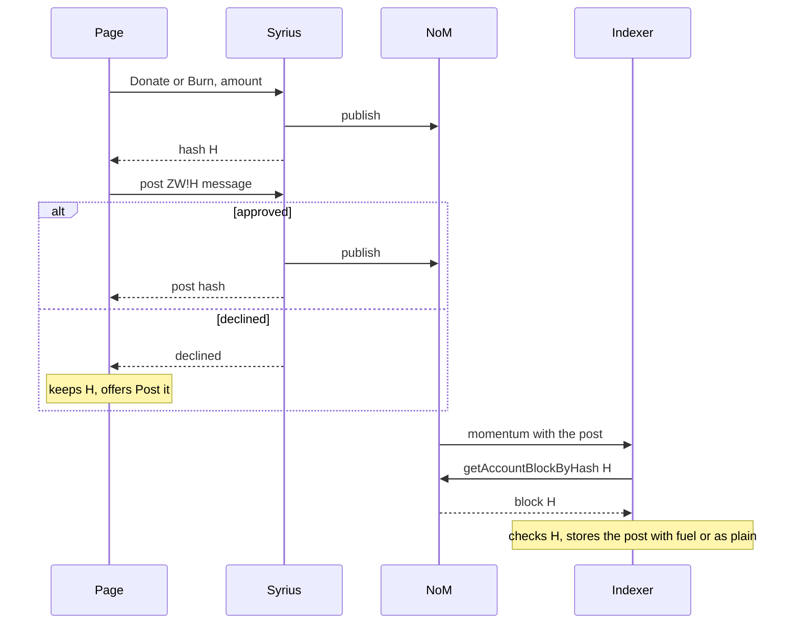

# Zenon Wall

A guestbook written into the Network of Momentum. Any send whose data starts
with `ZW` is a message on the wall, permanent and public. The page reads them
for anyone, and with the Syrius extension it posts one: a send of at least
1 ZNN to yourself, so you keep the ZNN and spend only plasma. Or put the ZNN
behind the post for good, donated to Accelerator-Z or burned, and the entry
shows it.

A revival of Sol Sanctum's [Zenon Wall at zenon.fun](https://forum.zenon.org/t/zenon-wall-zenon-fun/440)
(2022), split into three parts that do not know about each other:

| Part | What it is |
|---|---|
| [`indexer/`](indexer/) | Node 24 + TypeScript in Docker. Scans momentums for `ZW` sends and writes them to Supabase. |
| [`supabase/`](supabase/migrations/) | Two tables, `messages` and `indexer_state`. Anyone can read, nobody else can write. |
| [`web/`](web/) | Vue 3 page on the Zenon design system (`nom-ui`), static on GitHub Pages. Polls for new posts and posts through Syrius. |

**Setup:** [`docs/SETUP.md`](docs/SETUP.md) covers Supabase, the indexer, and
the page locally and on GitHub Pages.

## Posting

Connect the [Syrius extension](https://github.com/sol-znn/syrius-extension/releases)
(v0.3.4 or later; checked against v0.3.7) and a **Tag the Wall** box appears,
with one amount (1 ZNN or more) and three buttons:

| Button | Blocks | The ZNN |
|---|---|---|
| **Tag** | a send to yourself, data `ZW <message>` | kept |
| **Boost** | a Donate to Accelerator-Z, then a 0 ZNN post `ZW!<donation hash> <message>` | donated |
| **Torch** | a Burn through the token contract, then a 0 ZNN post `ZW!<burn hash> <message>` | burned |

The page builds each block; the wallet supplies the account, plasma and
signature and shows the block before signing, so no key is ever in the page. A
wallet on another chain is refused before signing. Messages are capped at 512
bytes.

Boost and Torch take two approvals. Donate and Burn accept only their 4-byte
selector as data, so the message cannot ride on them; the post that follows
names them instead. Syrius returns the first hash as soon as it publishes, so
the second prompt comes straight away. If the post is declined after the ZNN
went out, the page keeps the hash and offers to post again.

Syrius holds a site off for 30 s after a declined or closed approval; the page
waits that out and asks again. Without the page,
`znn-cli send <address> 1 ZNN "ZW Hello"` posts just as well; the indexer
accepts any amount, 0 included.

## What counts as a post

- A user send (block type 2) whose data starts with the bytes `Z` `W`,
  case-sensitive.
- The rest must be valid UTF-8; control characters other than tab and newline
  are removed and whitespace trimmed. Invalid or empty payloads are skipped.
- `ZW!<64 hex> <message>` names a block as the post's fuel. The indexer shows it
  only if that block is a Donate to Accelerator-Z or a Burn to the token
  contract, from the same account, sent before the post and confirmed, of at
  least 1 ZNN, and named by no earlier post. Otherwise it is a plain post.

The first post on mainnet is at momentum 1,341,650 (2022-05-04).

**Messages are hostile input.** People have already put
`<svg/onload=alert('XSS')>` on chain. The page only ever interpolates message
text (ESLint makes `v-html` an error), isolates bidi overrides, and ships a CSP
that allows connections to the configured Supabase origin only.

## Design

Follows the Zenon design system, through [`nom-ui`](https://github.com/digitalSloth/nom-ui):
Space Grotesk for interface and message text, JetBrains Mono with tabular
figures for heights, addresses and amounts, plasma only on the primary action,
light and dark. Kept from the original wall: the narrow single column, the year
dividers, every entry linking to its transaction, and the green rule along an
entry's bottom edge.
